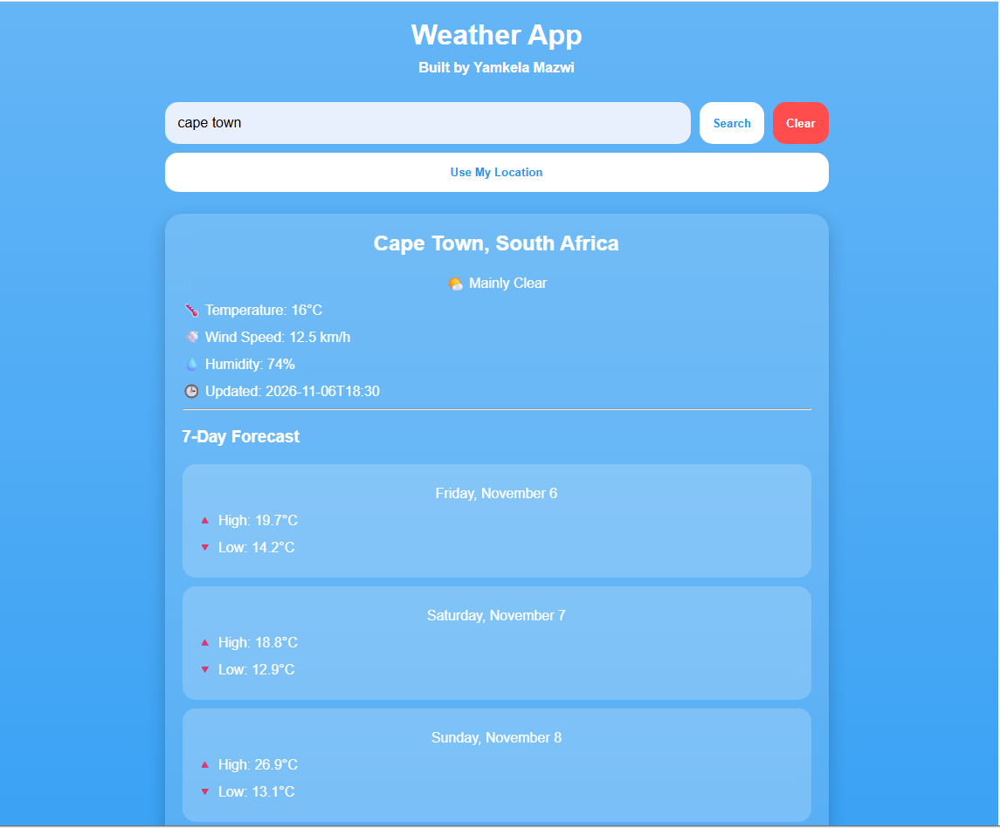

# 🌦️ Weather App


A modern weather application that allows users to search for any city and view current weather conditions and a 7-day forecast. The project consumes the Open-Meteo APIs and features dynamic weather backgrounds, responsive design, and geolocation functionality.

## 🚀 Live Demo

🔗 **Live Site:**  
https://yamkelamazwi.github.io/WeatherApp/

📂 **Repository:**  
https://github.com/yamkelamazwi/WeatherApp

---

## ✨ Features

- 🔍 Search weather by city
- 🌍 Geocoding API integration
- 🌡️ Current temperature display
- 💨 Wind speed information
- 💧 Humidity information
- ☁️ Weather condition descriptions
- 📅 7-Day forecast
- 📱 Mobile-first responsive design
- 🎨 Dynamic weather backgrounds
- 📍 Use My Location functionality
- 🧹 Clear button
- 🪟 Glassmorphism-inspired UI

---

## 🛠️ Technologies Used

- HTML5
- CSS3
- JavaScript (ES6)
- Open-Meteo Geocoding API
- Open-Meteo Weather API
- GitHub Pages

---
## 📸 Screenshot
<p align="center">
  
</p>

## 📚 What I Learned

This project helped strengthen my understanding of:

- Consuming REST APIs using Fetch
- JavaScript Async/Await
- Working with JSON data
- DOM manipulation
- Event handling
- Responsive mobile-first design
- Geolocation API basics
- Dynamic UI updates based on API data
- Converting raw API data into user-friendly information

One of the most important lessons was understanding how different APIs can work together. Before weather data could be retrieved, a city name first had to be converted into latitude and longitude coordinates using a geocoding API.

```text
City Name
    ↓
Geocoding API
    ↓
Latitude & Longitude
    ↓
Weather API
    ↓
Display Weather Data
```

---

## 🚧 Challenges & Pain Points

### Chaining Multiple APIs

One of the biggest challenges was understanding why weather data could not be requested directly from a city name.

I had to first use the Geocoding API to retrieve coordinates before sending those coordinates to the Weather API.

```javascript
City → Coordinates → Weather Data
```

Understanding this flow was a major breakthrough.

### Navigating Nested Data

Finding values inside deeply nested JSON responses was initially difficult.

For example:

```javascript
weatherData.current.temperature_2m
weatherData.current.wind_speed_10m
weatherData.current.relative_humidity_2m
```

Learning how to inspect API responses and locate the required values significantly improved my ability to work with APIs.

### Rendering Forecast Data

The 7-day forecast required looping through arrays and dynamically generating HTML.

```javascript
for (let i = 0; i < weatherData.daily.time.length; i++) {
  // Generate forecast cards
}
```

This helped me better understand iteration and dynamic user interfaces.

### Working With Dates

The API returned dates like:

```text
2026-11-06
```

I wanted a more user-friendly display:

```text
Friday
```

Learning how to use JavaScript's Date object and `toLocaleDateString()` solved this problem and improved the user experience.

### Mobile-First Design

Building mobile-first required careful decisions throughout development.

Several design ideas that looked good on desktop negatively affected the mobile experience, reinforcing the importance of designing for smaller screens first and enhancing layouts for larger devices afterward.

---

## 🔮 Future Improvements

- Add loading indicators
- Improve error handling
- Store recent searches with Local Storage
- Dark mode toggle
- Air quality information
- Sunrise and sunset times
- Additional weather condition icons
- Enhanced desktop forecast layout

---

## 👨‍💻 Author

### Yamkela Mazwi

Built as part of my front-end development portfolio.

### Other Projects

- 💱 Currency Exchange App
- 🐙 GitHub Profile Finder
- 🌦️ Weather App

---

⭐ If you found this project interesting, consider giving the repository a star!
